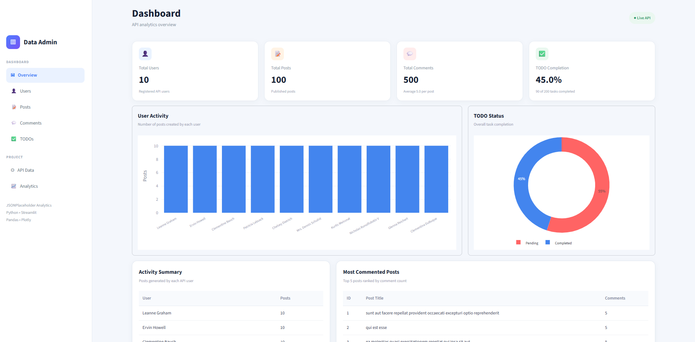
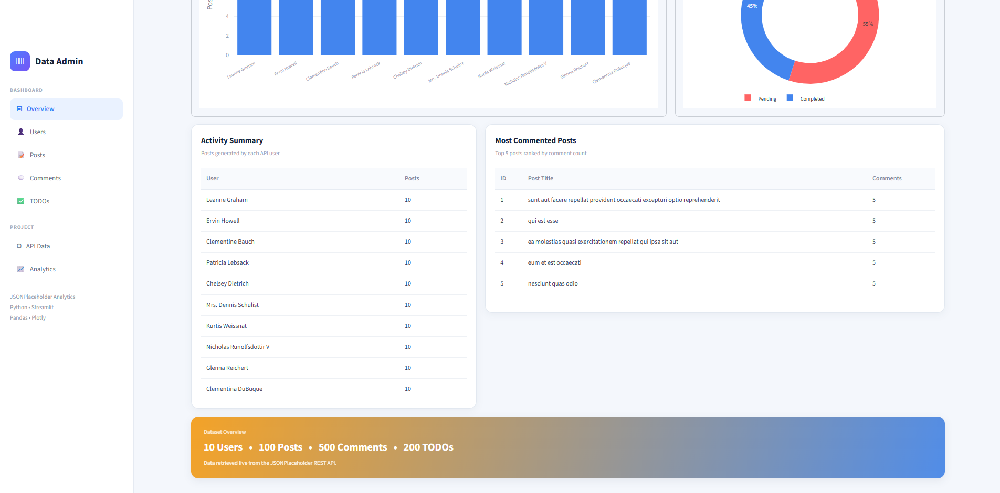

# JSONPlaceholder Data Analytics Dashboard

A simple interactive data analytics dashboard built with Python and Streamlit.

The project retrieves data from the public JSONPlaceholder REST API, processes it with Pandas, calculates useful statistics, and visualizes the results using Plotly.

## Features

The dashboard uses data from four API endpoints:

- `/users`
- `/posts`
- `/comments`
- `/todos`

The application calculates and displays:

- Total number of users
- Total number of posts
- Total number of comments
- Average number of comments per post
- Number of posts per user
- Percentage of completed TODO tasks
- Top 5 most commented posts

## Visualizations

The dashboard includes:

- Bar chart showing the number of posts per user
- Donut chart showing completed vs pending TODO tasks
- User activity table
- Top 5 most commented posts table

## Technologies Used

- Python
- Streamlit
- Pandas
- Requests
- Plotly

## Data Source

The project uses the public JSONPlaceholder REST API:

https://jsonplaceholder.typicode.com/

## Screenshots

### Dashboard Overview



### Dashboard Analytics



## Live Demo

[Open the live Streamlit dashboard](https://api-data-analytics-2.streamlit.app/)

## How to Run the Project Locally

Clone the repository:

```bash
git clone https://github.com/cheikhel/api-data-analytics.git

## How AI Was Used

ChatGPT was used as a development assistant throughout the project.

It helped with:

- understanding the internship requirements,
- planning the project step by step,
- improving code structure and error handling,
- debugging development and deployment issues,
- improving the Streamlit dashboard layout and visualizations,

The project was developed incrementally. Each feature was implemented, tested, and reviewed before moving to the next step.